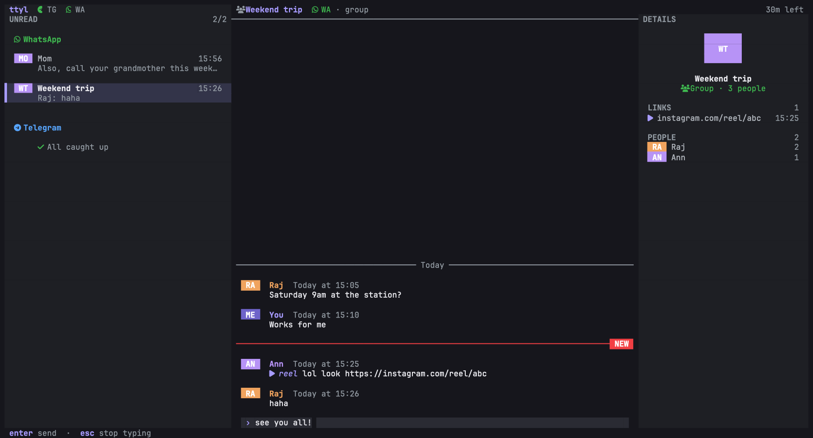

<div align="center">

# ttyl 💬

**your DMs in the terminal. no feed. no reels. no "seen". talk to you later.**

[](LICENSE)


WhatsApp, Telegram and Instagram chats in one keyboard-only TUI,
built for people who want to reply to their friends without losing an hour to the scroll.



<sub>sample data · Ghostty · dark theme</sub>

</div>

---

## why tho

You open Instagram to answer one DM. Forty minutes later you've watched 63 reels and still
haven't replied. ttyl fixes the "open app → get farmed" loop:

- **only conversations.** stories, reels, channels, status updates: never fetched, never shown.
- **only what's unread.** the chat list shows unread chats, grouped by app. everyone else is one
  `/` away (`w:` WhatsApp, `i:` Instagram, `t:` Telegram), or press `a` for all chats.
- **no "seen".** read receipts are off by default. reply when *you* want.
- **media stays text.** an icon and a label (`photo`, `voice 0:12`, `reel instagram.com/…`). nothing autoplays.
  press `o` when you actually want to look.
- **messages on your schedule.** set delivery windows (say 12:30 and 19:00) and everything in
  between waits. your people (VIPs) still get through.
- **a daily budget.** set 30 minutes; when it's gone, ttyl locks. you *can* type `extend`,
  but it's counted, and `ttyl stats` will show you. no judgement. ok, a little.

It won't cut your screen time (a terminal is still a screen 💀), but it cuts the stuff that was
never the point.

## what works

| | how ttyl connects | status |
|---|---|---|
| **WhatsApp** | linked device, scan a QR code | ✅ stable |
| **Telegram** | official API with your own `api_id` | ✅ works |
| **Instagram** | your browser session cookies | 🧪 experimental |

- Discord-style chat: who said what is obvious (colored names, avatars, "Today at 17:15")
- a details panel next to the chat (`space` `e`): who it is, shared media, links, files, and who talks in a group
- unread line, jump to first unread
- emoji by name while typing: `:jo` lists 😂 and friends, `tab` picks, `:heart:` turns into ❤️
- `/` opens a search box in the middle of the screen; results show as you type, `enter` opens
- on start, a full-screen loader with real counts until every app has caught up (`enter` skips it), so the chat list shows up complete
- fits any terminal from 30×8 up: narrow windows show the list or the chat, one at a time; very wide ones keep lines readable
- Nerd Font icons (JetBrainsMono Nerd Font etc.), with a plain-text fallback
- edits, unsends and reactions show up; media downloads only when you press `o`
- Gujarati, Hindi and emoji render correctly: ttyl measures how *your* terminal draws text at startup
- messages encrypted on disk, sessions and keys in the macOS Keychain

## install

You need **Go 1.26+** and **Xcode Command Line Tools** (`xcode-select --install`). Built and
tested on macOS.

```sh
git clone https://github.com/mitanshpatelll/ttyl
cd ttyl
make install        # puts `ttyl` in your $GOBIN
```

The first build takes a while (Telegram and Instagram libraries are big). After that it's quick.

## get going

```sh
ttyl                      # first run links WhatsApp: scan the QR
ttyl login telegram       # phone number → code → 2FA if you have it
ttyl login instagram      # paste a few cookies (read the warning first)
```

**WhatsApp:** phone → Settings → Linked devices → Link a device → scan. Your chats sync in a
few minutes. Your phone has to come online at least every ~14 days or WhatsApp unlinks it.

**Telegram:** grab a free `api_id` and `api_hash` at <https://my.telegram.org> → *API development
tools*, put them in the config (below), then `ttyl login telegram`.

**Instagram (experimental):** Meta doesn't allow unofficial clients, so an account *can* get
challenged or suspended. **Try a secondary account first.** Log in to instagram.com in a private
window, open devtools → Application → Cookies, copy `sessionid`, `csrftoken`, `ds_user_id`, then
close the window *without* logging out.

## keys

| key | does |
|---|---|
| `j` / `k` | move · select a message |
| `enter` | open a chat · send |
| `i` | reply |
| `o` | open the selected photo / voice note / file |
| `/` | search every chat (from the list or a chat) · `w:` `i:` `t:` for one app, e.g. `w: mom` · `↑` `↓` choose |
| `a` | all chats ↔ unread only |
| `space` `e` | details panel on / off (remembered) |
| `g` / `G` | top / bottom (going past the top loads older messages) |
| `esc` | back · stop typing |
| `?` | every key |
| `q` | quit |

```sh
ttyl stats                # your week: time, opens, sent, received, "extend"s
ttyl stats 30
ttyl logout telegram      # add --purge to also delete its stored messages
ttyl version
```

## config

`~/Library/Application Support/ttyl/config.toml` (created on first run):

```toml
[focus]
read_receipts = false          # true = send "seen" when you open a chat
windows = ["12:30", "19:00"]   # hold messages until these times · [] = live
vip = ["+919876543210"]        # WhatsApp numbers that skip the wait
daily_minutes = 30             # 0 = no budget

[ui]
icons = true                   # Nerd Font icons · false if you see boxes

[telegram]
api_id = 1234567
api_hash = "0123456789abcdef0123456789abcdef"
```

## privacy & security

Everything stays on your Mac, in `~/Library/Application Support/ttyl/` (owner-only):

- **`whatsapp.db`** is your WhatsApp login. Anyone with this file can read and send your messages.
  Never sync it, never commit it.
- **`ttyl.db`** holds your messages. Text, names and media links are encrypted
  (XChaCha20-Poly1305) with a key in your macOS Keychain. Phone numbers and timestamps are not.
- the **Telegram session** and **Instagram cookies** live in the Keychain (service `ttyl`).
- anything a contact sends is cleaned of terminal escape codes before it's shown, and opened
  files get macOS's quarantine flag. Scripts and apps are only revealed in Finder, never run.

ttyl uses unofficial protocols for WhatsApp ([whatsmeow](https://github.com/tulir/whatsmeow)) and
Instagram ([mautrix-meta](https://github.com/mautrix/meta)). Personal, low-volume use is the
norm for these, but it isn't sanctioned by Meta. Use it at your own risk.

## known limits

- sending is text only (no photos, replies or reactions *from* ttyl, yet)
- reading in ttyl doesn't clear unread on your phone unless `read_receipts = true`
- Telegram: reactions aren't shown; chats are caught up from your 100 most recent
- Instagram: recent messages + live only, no deep history, no end-to-end encrypted chats
- VIPs are WhatsApp numbers only

## how it's built

```
cmd/ttyl             commands, setup, account linking
internal/core        chats, messages, events: the same shape for every app
internal/platform/*  whatsapp (whatsmeow) · telegram (gotd) · instagram (instameow)
internal/app         events → store, focus rules, opening media, usage
internal/store       SQLite with migrations and at-rest encryption
internal/rules       delivery windows
internal/cellwidth   how wide text really is in your terminal
internal/secret      Keychain
internal/tui         the UI (Bubble Tea)
```

Each app's adapter turns its protocol into the same events; ttyl stores them in one database
and the UI reads from there. Delivery windows and VIPs are applied when reading, so nothing is
ever rewritten to hide or release messages.

```sh
make test           # vet + tests
TTYL_GALLERY=1 go test -run Gallery -v ./internal/tui   # print every screen
```

## license

[MIT](LICENSE) © 2026 Mitansh Patel. Do what you want with it, just keep the notice.

Built with [Bubble Tea](https://github.com/charmbracelet/bubbletea),
[whatsmeow](https://github.com/tulir/whatsmeow), [gotd](https://github.com/gotd/td) and
[mautrix-meta](https://github.com/mautrix/meta). 🫶

<div align="center"><sub>ttyl. go touch grass. 🌱</sub></div>
